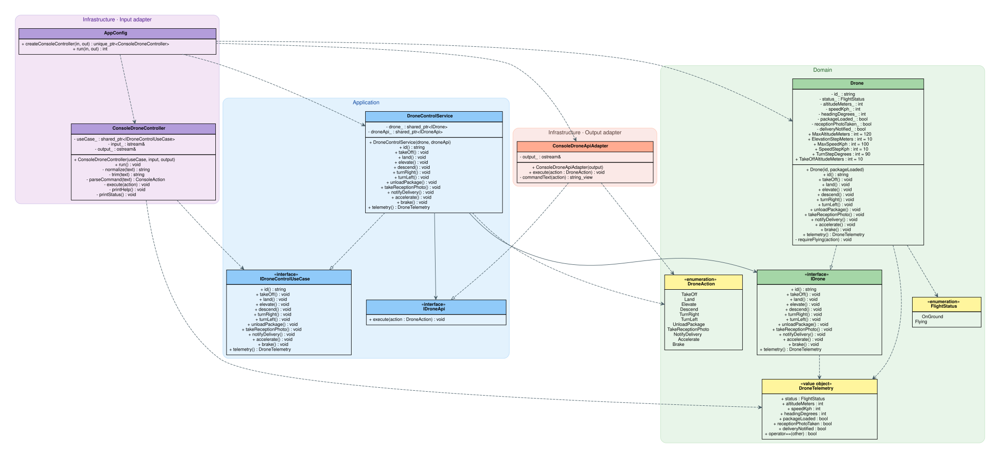
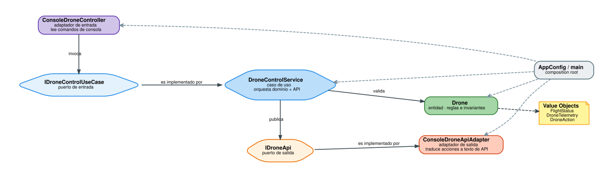

# Diseño, decisiones y trazabilidad

Este documento explica cómo se resolvió el trabajo práctico **Drone IBag151**,
qué decisiones de diseño se tomaron y cómo se aplicaron los conceptos de
arquitectura hexagonal, SOLID, GRASP, TDD, Clean Code, RAII y STL.

## 1. Problema y alcance

La empresa de reparto necesita una aplicación de consola para manejar el drone
**IBag151**. La API que controla físicamente al drone se representa mediante
texto: cada comando validado se imprime en consola y ese texto es el que se
considera enviado a la API. Las actividades requeridas son:

1. Despegar.
2. Aterrizar.
3. Elevar.
4. Bajar.
5. Girar a la derecha.
6. Girar a la izquierda.
7. Descargar el paquete.
8. Sacar la foto de la recepción.
9. Notificar la entrega.
10. Acelerar.
11. Frenar.

Además se implementan comandos de soporte `estado`, `ayuda` y `salir`, y un
protocolo de entrega que impide notificar una entrega sin haber descargado el
paquete y tomado la foto.

## 2. Arquitectura hexagonal

### 2.1 Capas y regla de dependencia

```text
┌──────────────────────────── Adaptadores de entrada ────────────────────────────┐
│ ConsoleDroneController                                                         │
└───────────────────────────────────┬────────────────────────────────────────────┘
                                    │ depende de
                                    ▼
┌──────────────────────────── Aplicación ────────────────────────────────────────┐
│ IDroneControlUseCase  ◄──  DroneControlService                                 │
│                                   │                                            │
│                                   │ depende de                                 │
└───────────────────────────────────┼────────────────────────────────────────────┘
                                    ▼
┌──────────────────────────── Dominio ───────────────────────────────────────────┐
│ IDrone  ◄──  Drone          DroneTelemetry   FlightStatus   DroneAction        │
│ IDroneApi (puerto de salida)                                                   │
└───────────────────────────────────▲────────────────────────────────────────────┘
                                    │ implementa
┌──────────────────────────── Adaptadores de salida ─────────────────────────────┐
│ ConsoleDroneApiAdapter                                                         │
└────────────────────────────────────────────────────────────────────────────────┘
```

La dependencia siempre apunta hacia adentro:

```text
Infraestructura → Aplicación → Dominio
```

El dominio solo usa la biblioteca estándar. No incluye `iostream`, CMake,
GoogleTest ni código de infraestructura. La aplicación depende de las
abstracciones `IDrone` e `IDroneApi`, nunca de `Drone` ni de
`ConsoleDroneApiAdapter`. La infraestructura es la única capa que conoce la
consola y el formato textual de la API.

### 2.2 Puertos y adaptadores

| Puerto | Tipo | Ubicación | Implementación |
|---|---|---|---|
| `IDroneControlUseCase` | Entrada | `application/ports/in` | `DroneControlService` |
| `IDrone` | Salida interna del dominio | `domain/entities` | `Drone` |
| `IDroneApi` | Salida | `domain/ports/out` | `ConsoleDroneApiAdapter` |
| `ConsoleDroneController` | Adaptador de entrada | `infrastructure/adapters/in` | Consola (`istream` / `ostream`) |
| `ConsoleDroneApiAdapter` | Adaptador de salida | `infrastructure/adapters/out` | Texto hacia la API simulada |
| `AppConfig` | Composition root | `infrastructure/config` | Crea y conecta los objetos |

`IDrone` se ubica en `domain/entities` porque es la interfaz de la entidad y
permite sustituirla en pruebas. `IDroneApi` se ubica en `domain/ports/out`
siguiendo la estructura del boilerplate de la cátedra.

### 2.3 Flujo de un comando

```text
Consola
  │  "despegar"
  ▼
ConsoleDroneController      (parsea, normaliza y despacha)
  │  IDroneControlUseCase::takeOff()
  ▼
DroneControlService         (orquesta el caso de uso)
  │  IDrone::takeOff()
  ▼
Drone                       (valida reglas e invariantes y actualiza estado)
  │  IDroneApi::execute(DroneAction::TakeOff)
  ▼
ConsoleDroneApiAdapter      (traduce la acción a texto)
  │
  ▼
[API Drone] DESPEGAR
```

La API se invoca **después** de que el dominio acepta la operación. Si el
dominio rechaza la acción (por ejemplo, aterrizar estando en tierra), se lanza
`std::domain_error`, el controlador lo informa y no se envía ningún texto a la
API. Esto mantiene coherentes el estado del drone y el protocolo de comandos.

### 2.4 Estructura de carpetas

La separación sigue el ejemplo `ExampleHexagonalArchitectureBoilerPlate`:

```text
include/application/ports/in
include/application/services
include/domain/entities
include/domain/ports/out
include/domain/valueObjects
include/infrastructure/adapters/in
include/infrastructure/adapters/out
include/infrastructure/config
src/...
tests/...
public/docs/...
```

Se agregaron `application/services` y `infrastructure/adapters/in` porque el
boilerplate solo contenía carpetas vacías y el caso de uso concreto y el
adaptador de consola son necesarios para una aplicación ejecutable. El resto de
la organización respeta el ejemplo.

## 3. Modelo de dominio

### 3.1 Entidad `Drone`

`Drone` es una entidad rica: no es un simple contenedor de datos. Concentra el
estado y las reglas de negocio, y protege sus invariantes en cada operación.

Valores iniciales:

| Campo | Inicial | Significado |
|---|---|---|
| `status_` | `OnGround` | El drone comienza en tierra |
| `altitudeMeters_` | 0 | Altitud en metros |
| `speedKph_` | 0 | Velocidad en km/h |
| `headingDegrees_` | 0 | Rumbo (0 = norte) |
| `packageLoaded_` | `true` | El drone sale con un paquete |
| `receptionPhotoTaken_` | `false` | Foto pendiente |
| `deliveryNotified_` | `false` | Entrega pendiente de notificar |

Constantes del modelo:

| Constante | Valor | Uso |
|---|---:|---|
| `TakeOffAltitudeMeters` | 10 | Altitud inicial de vuelo |
| `ElevationStepMeters` | 10 | Incremento/decremento por elevación |
| `MaxAltitudeMeters` | 120 | Altitud máxima |
| `SpeedStepKph` | 10 | Incremento/decremento de velocidad |
| `MaxSpeedKph` | 100 | Velocidad máxima |
| `TurnStepDegrees` | 90 | Giro por comando |

### 3.2 Reglas e invariantes

| Operación | Precondición | Efecto | Error si no se cumple |
|---|---|---|---|
| `takeOff` | En tierra | Pasa a `Flying`, altitud 10 m | `domain_error`: ya está en vuelo |
| `land` | En vuelo | Pasa a `OnGround`, altitud 0, velocidad 0 | `domain_error`: ya está en tierra |
| `elevate` | En vuelo y altitud < 120 | Suma 10 m hasta 120 | `domain_error`: debe volar / altitud máxima |
| `descend` | En vuelo y altitud > 10 | Resta 10 m | `domain_error`: debe volar / altitud mínima |
| `turnRight` | En vuelo | Rumbo + 90° con módulo 360 | `domain_error`: debe volar |
| `turnLeft` | En vuelo | Rumbo − 90° con módulo 360 | `domain_error`: debe volar |
| `unloadPackage` | Paquete cargado | Marca paquete descargado | `domain_error`: no hay paquete |
| `takeReceptionPhoto` | Paquete descargado y foto no tomada | Marca foto tomada | `domain_error`: falta descargar / foto ya tomada |
| `notifyDelivery` | Foto tomada y entrega no notificada | Marca entrega notificada | `domain_error`: falta foto / ya notificada |
| `accelerate` | En vuelo y velocidad < 100 | Suma 10 km/h hasta 100 | `domain_error`: debe volar / velocidad máxima |
| `brake` | En vuelo | Resta 10 km/h hasta 0 | `domain_error`: debe volar |

El protocolo de entrega queda expresado como una secuencia natural:

```text
aterrizar → descargar → foto → notificar
```

`unloadPackage`, `takeReceptionPhoto` y `notifyDelivery` no exigen estar en vuelo
porque el modelo no impone que la descarga se haga en el aire: la regla relevante
es el orden de la entrega y la unicidad de cada evento.

### 3.3 Value Objects

- `FlightStatus`: enumeración `OnGround` / `Flying`.
- `DroneAction`: enumeración de las once acciones que entiende el puerto de
  salida. Evita strings mágicos entre aplicación e infraestructura.
- `DroneTelemetry`: snapshot inmutable de solo lectura del estado del drone.
  Desacopla la presentación del estado interno de la entidad y facilita las
  pruebas. Incluye `operator==` para comparaciones simples.

`telemetry()` devuelve una copia por valor. El tamaño es pequeño y así el
adaptador de consola no puede modificar el estado interno del drone.

### 3.4 Manejo de errores

Se usa `std::domain_error` de la biblioteca estándar. Es una excepción estándar,
conocida por cualquier consumidor, y comunica que se violó una regla de negocio.
No se creó una jerarquía de excepciones propia porque no aportaba valor en este
alcance. El adaptador de entrada captura `std::exception` en el bucle de consola,
muestra el mensaje y permite seguir operando.

## 4. Capa de aplicación

`DroneControlService` es el caso de uso concreto. Implementa
`IDroneControlUseCase` y colabora con dos abstracciones:

- `std::shared_ptr<IDrone>`: entidad de dominio.
- `std::shared_ptr<IDroneApi>`: puerto de salida hacia la API.

Cada método hace dos pasos explícitos:

```cpp
drone_->takeOff();                                // 1. regla de dominio
droneApi_->execute(DroneAction::TakeOff);         // 2. publicación a la API
```

No se usó una plantilla ni un helper con punteros a método porque con once
métodos la versión explícita es más legible y depurable. Si el número de
acciones creciera, podría evaluarse una tabla de operaciones.

El constructor valida que las dependencias no sean nulas y lanza
`std::invalid_argument` si lo son. Esto evita fallos diferidos y hace explícito
el contrato del servicio.

## 5. Infraestructura

### 5.1 Adaptador de entrada

`ConsoleDroneController`:

- Lee líneas con `std::getline`.
- Normaliza con `trim` y `std::tolower`.
- Traduce el texto a una acción interna mediante un
  `std::unordered_map<std::string, ConsoleAction>`.
- Despacha al puerto `IDroneControlUseCase`.
- Muestra telemetría y ayuda.
- Captura excepciones y las presenta como `[Error] ...`.
- Acepta alias (`derecha`, `girar derecha`, `girar-derecha`).

Los textos de la interfaz no se envían a la API: solo las acciones de control
del drone pasan por el adaptador de salida. Los prompts, la ayuda, el estado y
los errores son responsabilidad de la interfaz de consola.

### 5.2 Adaptador de salida

`ConsoleDroneApiAdapter` implementa `IDroneApi`. Recibe un `std::ostream&` no
propietario y traduce cada `DroneAction` a su texto de protocolo:

```text
[API Drone] DESPEGAR
```

La correspondencia acción → texto está centralizada en `commandText`, lo que
evita strings dispersos y facilita agregar un futuro adaptador HTTP o MQTT.

### 5.3 Composition root

`AppConfig` es el único lugar que conoce las clases concretas. Crea:

```cpp
auto drone = std::make_shared<Drone>("IBag151");
auto droneApi = std::make_shared<ConsoleDroneApiAdapter>(output);
auto useCase = std::make_shared<DroneControlService>(drone, droneApi);
return std::make_unique<ConsoleDroneController>(useCase, input, output);
```

`main` solo delega en `AppConfig::run()`. La infraestructura queda conectada sin
contaminar la aplicación ni el dominio.

## 6. SOLID

| Principio | Aplicación concreta |
|---|---|
| **S**ingle Responsibility | `Drone` modela estado y reglas; `DroneControlService` orquesta; los adaptadores hacen E/S; `AppConfig` compone. |
| **O**pen/Closed | Se pueden agregar acciones o adaptadores sin modificar la entidad para cosas ajenas a su estado. El adaptador de salida se reemplaza sin tocar el dominio. |
| **L**iskov Substitution | `Drone` es sustituible por cualquier `IDrone`; `ConsoleDroneApiAdapter` por cualquier `IDroneApi`; las pruebas usan dobles que respetan el contrato. |
| **I**nterface Segregation | `IDrone`, `IDroneApi` e `IDroneControlUseCase` son interfaces pequeñas y específicas. `IDroneApi` solo expone `execute`, no toda la entidad. |
| **D**ependency Inversion | Aplicación y adaptadores dependen de abstracciones; las implementaciones concretas se inyectan desde `AppConfig`. |

## 7. GRASP

| Patrón | Dónde se aplica |
|---|---|
| **Information Expert** | `Drone` es el experto en su estado y decide si una operación es válida. |
| **Creator** | `AppConfig` crea el grafo de objetos; `Drone` produce su `DroneTelemetry`. |
| **Controller** | `ConsoleDroneController` recibe la entrada del usuario y coordina el caso de uso. |
| **Low Coupling** | Puertos, `DroneAction` y `DroneTelemetry` reducen el acoplamiento entre capas. |
| **High Cohesion** | Cada clase tiene una responsabilidad clara y un conjunto pequeño de métodos relacionados. |
| **Polymorphism** | `IDrone`, `IDroneApi` e `IDroneControlUseCase` permiten sustitución. |
| **Protected Variations** | Los puertos protegen al dominio de cambios en la consola o en la API externa. |
| **Pure Fabrication** | `DroneControlService` es un servicio artificial que coordina sin cargar al dominio con detalles de infraestructura. |
| **Indirection** | Adaptadores y puertos intermedian entre la consola, la aplicación y la API. |
| **Don't Talk to Strangers** | El controlador habla con el caso de uso; el caso de uso con el dominio y el puerto de salida. |

## 8. Patrones GoF: decisión explícita

No se forzó ningún patrón GoF. La arquitectura hexagonal ya resuelve el problema
de variación principal mediante puertos y adaptadores, y el dominio es lo
suficientemente simple como para no necesitar una jerarquía de patrones.

Se evaluó el patrón **Command** para encapsular cada acción en un objeto con
`execute()`. Se descartó porque:

- `DroneAction` ya es un value object enum tipado y suficiente.
- Habría que crear once clases para operaciones que no requieren undo/redo,
  encolamiento ni composición.
- El adaptador de salida ya polimórfico es el punto de variación correcto.

Si en el futuro se necesitara historial, deshacer o una cola de comandos, el
patrón Command sería una evolución justificada. Del mismo modo, el término
"adaptador" de la arquitectura hexagonal no implica usar el patrón GoF Adapter:
aquí los adaptadores traducen entre el mundo externo y los puertos.

## 9. TDD y estrategia de pruebas

### 9.1 Ciclo de trabajo

Se trabajó en ciclos **Red → Green → Refactor** por capa:

1. **Rojo:** se escribió primero la prueba de la actividad o regla.
2. **Verde:** se implementó lo mínimo necesario para pasarla.
3. **Refactor:** se extrajeron constantes, se mejoraron nombres y se eliminó
   duplicación, manteniendo la suite verde.

El orden seguido fue:

```text
Dominio → Aplicación → Adaptadores → Integración de consola
```

Las pruebas de dominio no dependen de GoogleTest para la lógica: solo lo usan
como runner. Las pruebas de aplicación usan un `FakeDroneApi` que captura las
acciones en un `std::vector`. Las pruebas de infraestructura usan
`std::istringstream` / `std::ostringstream` y un `FakeDroneControlUseCase`, sin
tocar la consola real.

### 9.2 Matriz de trazabilidad

| Actividad | Comando | Pruebas de dominio | Prueba de aplicación | Pruebas de infraestructura |
|---|---|---|---|---|
| Despegar | `despegar` | `DroneTakeOffTest.*` | `TakeOffUpdatesTheDroneAndSendsTheApiAction` | `DispatchesEveryActivity...`, `TranslatesEveryActivity...` |
| Aterrizar | `aterrizar` | `DroneLandTest.*` | `LandUpdatesTheDroneAndSendsTheApiAction` | idem |
| Elevar | `elevar` | `DroneElevateTest.*` | `ElevateUpdatesTheDroneAndSendsTheApiAction` | idem |
| Bajar | `bajar` | `DroneDescendTest.*` | `DescendUpdatesTheDroneAndSendsTheApiAction` | idem |
| Girar derecha | `derecha` | `DroneTurnRightTest.*` | `TurnRightUpdatesTheDroneAndSendsTheApiAction` | idem |
| Girar izquierda | `izquierda` | `DroneTurnLeftTest.*` | `TurnLeftUpdatesTheDroneAndSendsTheApiAction` | idem |
| Descargar | `descargar` | `DroneUnloadPackageTest.*` | `UnloadPackageUpdatesTheDroneAndSendsTheApiAction` | idem |
| Foto | `foto` | `DroneReceptionPhotoTest.*` | `TakeReceptionPhotoUpdatesTheDroneAndSendsTheApiAction` | idem |
| Notificar | `notificar` | `DroneNotifyDeliveryTest.*` | `NotifyDeliveryUpdatesTheDroneAndSendsTheApiAction` | idem |
| Acelerar | `acelerar` | `DroneAccelerateTest.*` | `AccelerateUpdatesTheDroneAndSendsTheApiAction` | idem |
| Frenar | `frenar` | `DroneBrakeTest.*` | `BrakeUpdatesTheDroneAndSendsTheApiAction` | idem |

Pruebas transversales destacadas:

- Estado inicial y validación de identificador vacío.
- Rechazo de operaciones de vuelo en tierra.
- Límites de altitud y velocidad.
- Orden de la entrega y prohibición de repetir descarga, foto o notificación.
- Una acción rechazada por el dominio no genera comando de API.
- El controlador acepta mayúsculas, espacios y alias.
- El controlador informa errores de dominio sin cortar el bucle de consola.
- El adaptador de salida traduce correctamente todas las acciones.
- `estado`, `ayuda` y comandos desconocidos no invocan al caso de uso.

### 9.3 Ejecución

```bash
cmake --preset debug
cmake --build --preset debug
ctest --preset debug
```

Resultado esperado: **53 tests, 0 fallos**.

## 10. RAII y punteros inteligentes

- No hay `new`/`delete` manuales ni punteros propietarios crudos.
- `AppConfig` crea el controlador con `std::make_unique` y lo devuelve por
  `std::unique_ptr`; su ciclo de vida termina con el ámbito de `run()`.
- El drone, la API y el caso de uso se comparten con `std::make_shared`.
  `DroneControlService` guarda `std::shared_ptr` a sus colaboradores porque son
  dependencias de larga vida y se inyectan desde el composition root.
- Los adaptadores guardan referencias no propietarias a `std::istream` y
  `std::ostream`; los streams pertenecen a `main`/`AppConfig` y sobreviven al
  adaptador.
- Todas las interfaces tienen destructor virtual (`virtual ~... = default`).
- La opción `DRONE_ENABLE_SANITIZERS=ON` permite compilar con ASan/UBSan para
  detectar fugas y accesos inválidos.

## 11. Uso de la STL y Clean Code

- `std::vector<DroneAction>` en el fake de API para registrar el historial.
- `std::unordered_map<std::string, ConsoleAction>` para el despacho de comandos.
- `std::string_view` para textos no propietarios y para el mapeo de acciones.
- `std::string` para identidad y mensajes propios.
- `std::pair` y `std::vector` para la tabla de ayuda.
- `std::min`, `std::max`, `std::transform`, `std::tolower`.
- `std::domain_error` y `std::invalid_argument` para errores claros.
- Constantes con nombre en `Drone` en lugar de números mágicos.
- Funciones cortas, nombres intencionales y ausencia de comentarios obvios.
- El dominio no imprime: devuelve estado o lanza errores; la presentación queda
  en infraestructura.

## 12. Diagramas

### Diagrama de clases



- Fuente editable: [`DroneIBag151-ClassDiagram.drawio`](DroneIBag151-ClassDiagram.drawio)
- Fuente Graphviz: [`class-diagram.dot`](class-diagram.dot)
- Exportaciones: `class-diagram.svg` y `class-diagram.png`.

### Diagrama de arquitectura hexagonal



- Fuente editable: [`DroneIBag151-HexagonalArchitecture.drawio`](DroneIBag151-HexagonalArchitecture.drawio)
- Fuente Graphviz: [`hexagonal-architecture.dot`](hexagonal-architecture.dot)
- Exportaciones: `hexagonal-architecture.svg` y `hexagonal-architecture.png`.

Los `.drawio` se abren con [diagrams.net](https://app.diagrams.net/) o con la
extensión **Draw.io Integration** de VS Code. Los `.dot` se regeneran con:

```bash
dot -Tsvg public/docs/class-diagram.dot -o public/docs/class-diagram.svg
dot -Tsvg public/docs/hexagonal-architecture.dot \
    -o public/docs/hexagonal-architecture.svg
```

## 13. Decisiones de arquitectura (ADR resumidas)

| ID | Decisión | Motivo |
|---|---|---|
| ADR-001 | Usar C++17 | `std::string_view`, `constexpr` inline y `std::make_unique`; compatible con la cátedra. |
| ADR-002 | Errores de negocio con `std::domain_error` | Estándar, simple y suficiente; evita jerarquías innecesarias. |
| ADR-003 | Simular la API imprimiendo el texto | Requisito del enunciado; permite probar sin hardware. |
| ADR-004 | No introducir patrones GoF | No había problema de variación que los justificara; se priorizó simplicidad. |
| ADR-005 | GoogleTest vía `find_package` y `FetchContent` | Funciona con GTest del sistema o lo descarga si no existe. |
| ADR-006 | Bibliotecas CMake separadas por capa | La regla de dependencia se verifica también en el enlazado. |
| ADR-007 | `shared_ptr` para colaboradores inyectados y `unique_ptr` para el controlador | Refleja propiedad compartida de dependencias de larga vida y propiedad exclusiva del composition root. |
| ADR-008 | Orden de entrega descarga → foto → notificación | Regla de negocio explícita y testeable, derivada del enunciado. |
| ADR-009 | Telemetría como value object copiable | Presentación desacoplada y pruebas simples. |

## 14. Limitaciones y evolución posible

- No se conecta a un drone real: el adaptador de salida simula la API por consola.
- Hay una sola instancia de drone.
- No hay persistencia de estado ni historial de comandos.
- No se modelan batería, coordenadas GPS, viento ni obstáculos.
- No hay concurrencia; el bucle de consola es secuencial.

Evoluciones naturales:

- Un adaptador `HttpDroneApiAdapter` o `MqttDroneApiAdapter` que implemente el
  mismo `IDroneApi`.
- Un patrón Command con cola, undo/redo e historial si el producto lo requiere.
- Persistencia de telemetría y eventos de entrega.
- Pruebas de contrato compartidas para todos los adaptadores de `IDroneApi`.
- Interfaz gráfica como nuevo adaptador de entrada, sin tocar dominio ni
  aplicación.
